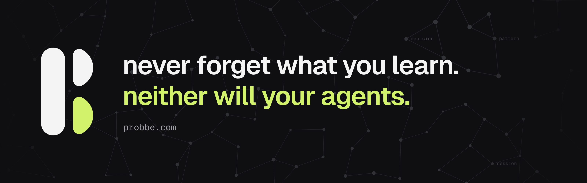

<a href="https://probbe.com"><picture><source media="(prefers-color-scheme: dark)" srcset="https://raw.githubusercontent.com/probbed/.github/main/profile/assets/banner-dark.png"><source media="(prefers-color-scheme: light)" srcset="https://raw.githubusercontent.com/probbed/.github/main/profile/assets/banner-light.png"></picture></a>

**probbe** is a open source **second brain** local-first for you and your AI agents.

- **Teach one agent, and they all know.** Tell Claude Code how your project works, and Codex follows it the next day without being asked.
- **Keeps human and AI memory apart.** Agents only write to their own folder, and nothing gets promoted without your decision.
- **Remembers more than code.** Keep notes, decisions and saved articles in one vault you can version.

[probbe.com](https://probbe.com)
